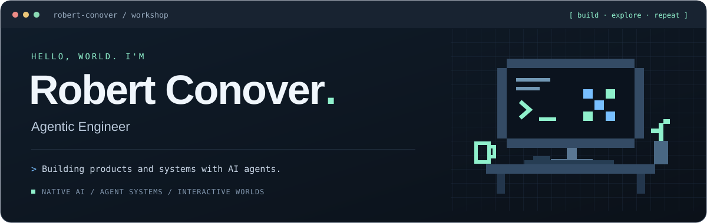
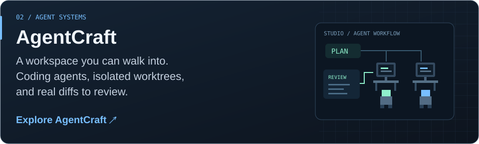
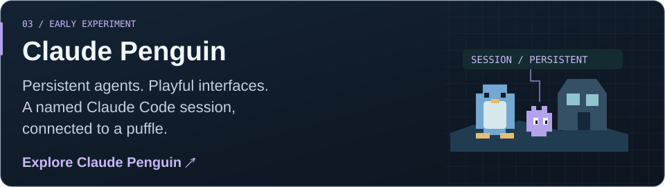

  

<a href="https://github.com/Robert-Conover/Dualo">
<picture>
  <source media="(max-width: 600px)" srcset="assets/dualo-mobile.svg">
  
</picture>
</a>

 

<a href="https://github.com/Robert-Conover/agentcraft">
<picture>
  <source media="(max-width: 600px)" srcset="assets/agentcraft-mobile.svg">
  
</picture>
</a>

 

<a href="https://github.com/Robert-Conover/claude-penguin">
<picture>
  <source media="(max-width: 600px)" srcset="assets/claude-penguin-mobile.svg">
  
</picture>
</a>

<h3>And sometimes, a different kind of intelligence.</h3>

<a href="https://github.com/Robert-Conover/doomfly"><strong>DOOMFLY ↗</strong></a> — A fly-connectome simulation wired into a Doom arena. An ongoing research experiment, with its results and limitations documented.

<code>Swift / SwiftUI</code> &nbsp; <code>TypeScript</code> &nbsp; <code>Python</code> &nbsp; <code>Local inference</code> &nbsp; <code>Agent tooling</code>

<a href="https://github.com/Robert-Conover?tab=repositories"><strong>Explore all repositories ↗</strong></a>

