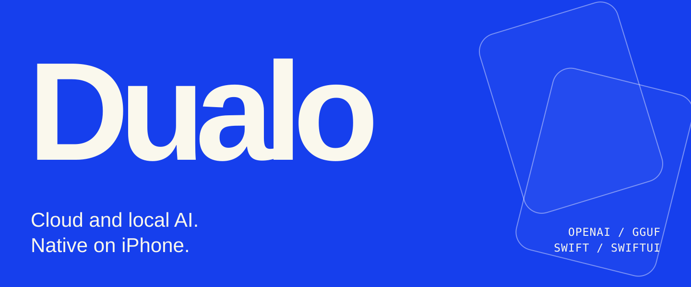
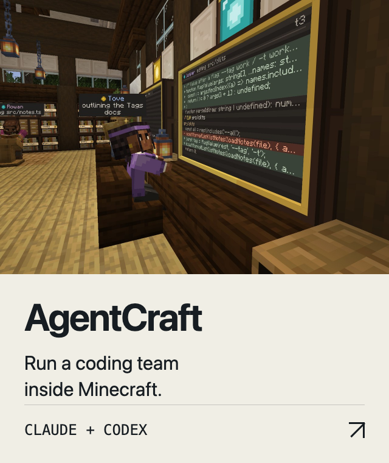
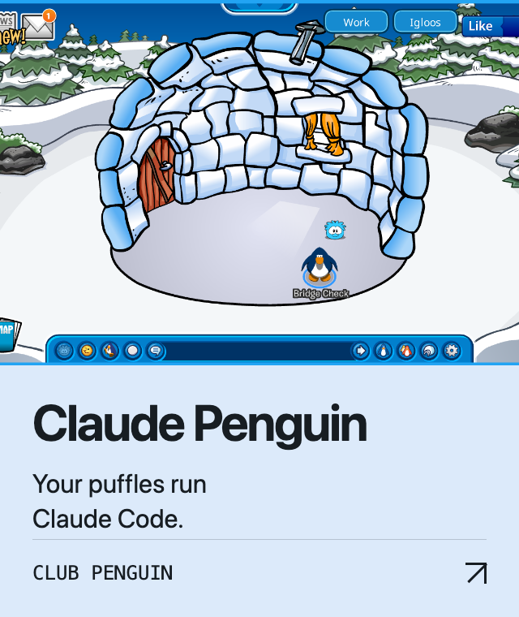

<picture><source media="(max-width: 600px)" srcset="assets/header-mobile.svg"></picture>

<a href="https://github.com/Robert-Conover/Dualo">
<picture>
  <source media="(max-width: 600px)" srcset="assets/dualo-mobile.svg">
  
</picture>
</a>

<a href="https://github.com/Robert-Conover/agentcraft"><picture><source media="(max-width: 600px)" srcset="assets/agentcraft-mobile.png"></picture></a> <a href="https://github.com/Robert-Conover/claude-penguin"><picture><source media="(max-width: 600px)" srcset="assets/claude-penguin-mobile.png"></picture></a>

